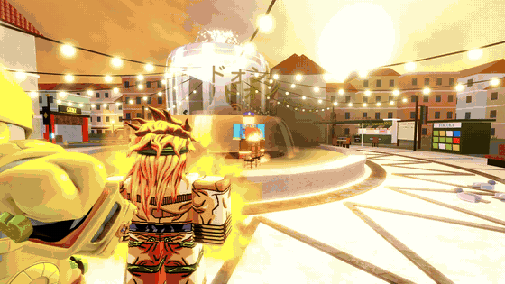
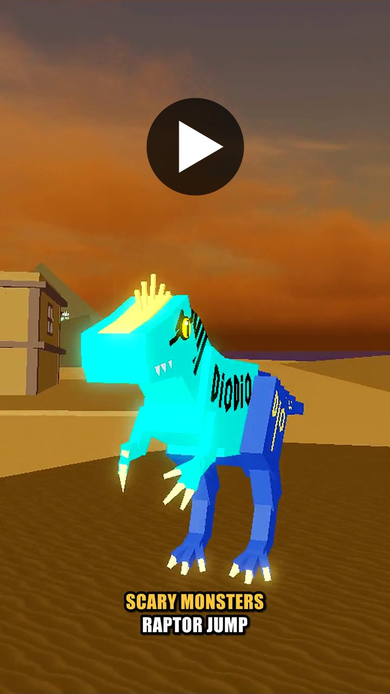

# JoJo: Steel Ball Crusaders

A multiplayer action RPG on Roblox, written in Luau. Players unlock Stands with their own ability kits, fight through quests and enemies, and duel each other in PvP.

This repo holds the original game's source and its full commit history. The game has since been renamed **JoJo: Stand Legacy**, and that version continues in **[JoJoStandLegacy](https://github.com/chillinturt/JoJoStandLegacy)**.

**[Play on Roblox](https://www.roblox.com/games/118168989887674/JoJo-Stand-Legacy)** (PC, iOS, Android)



*Footage is from the current version.*

**Trailer (43 s, with sound):** Scary Monsters and Hanged Man, two Stands added to the current version from player requests. Click to watch on YouTube.

<a href="https://www.youtube.com/shorts/AmFCrTdopaE"></a>


## What's in the game

- 40+ Stands, each with its own abilities, plus specialty fighting styles
- Melee, projectile and area attacks, with blocking, stuns and shared combat rules
- Enemy NPCs, quest chains, inventory, talents and levelling to 120
- Three save slots per player, each a separate character
- 1v1 and King of the Hill modes
- Boats and an ocean, the newest and least finished systems

## How the main systems work

**Combat runs on the server.** A key press only sends a request. The server checks cooldowns and state, runs the Stand's ability module, and applies damage through shared hitbox and combat code. NPCs take damage through the same path as players, so there's no separate NPC combat system.

**Effects run on the clients.** The server sends a short description of each effect, and one client script builds and plays it. Heavy particle work stays off the server.

**Abilities are organized by folder.** Each Stand has its own module and ability registry on top of the shared combat code, so a new kit doesn't need new damage or hit-detection code.

**Saves are session-locked.** Player data goes through the [ProfileStore](https://github.com/MadStudioRoblox/ProfileStore) library, so two servers can't write to one profile at once. Purchase history is saved so a repeated receipt isn't granted twice.

More detail, including what I'd change, is in **[docs/ARCHITECTURE.md](docs/ARCHITECTURE.md)**.

## Where to start reading

| File | What it does |
|---|---|
| [`AbilityHandler.luau`](src/server/BasicCombat/StandModules/Handlers/AbilityHandler.luau) | Press, hold and toggle handling, plus cooldowns, for every Stand |
| [`HitboxSpawner.luau`](src/server/BasicCombat/HitboxSpawner.luau) | Melee, projectile, guided and damage-over-time hit detection |
| [`VfxClientManager.client.luau`](src/client/VfxClientManager.client.luau) | The one client script that plays server-requested effects |
| [`PlayerData.luau`](src/server/DataSaving/PlayerData.luau) | Loading, saving and switching character slots |

## Team and tools

I'm the team lead. I did the programming and most of the building, and teammates helped build in-game assets and collect online assets. I set up the technical constraints so they could work without needing code changes.

I wrote the earliest prototypes, including hitboxes, Stand summoning and abilities, without AI, then used Claude Code to improve them over time. I'm happy to walk through any system here and explain how it works.

Built with Luau, Roblox Studio and Rojo.

## Running it

```sh
rokit install
rojo serve
```

Then connect with the Rojo plugin in Roblox Studio. The place file (maps, models, UI and effects) isn't in this repo, so the code alone won't give you the full game. [The live game](https://www.roblox.com/games/118168989887674/JoJo-Stand-Legacy) is the easiest way to see it running.

## Legal

This is an unofficial fan project, not affiliated with or endorsed by the owners of *JoJo's Bizarre Adventure*, whose characters and names belong to them. The MIT license covers my code only. `ProfileStore.luau` is third-party code under its own terms.

## Author

**ChillinTurt**, software engineering student. I also work in C++, Python and C#.
