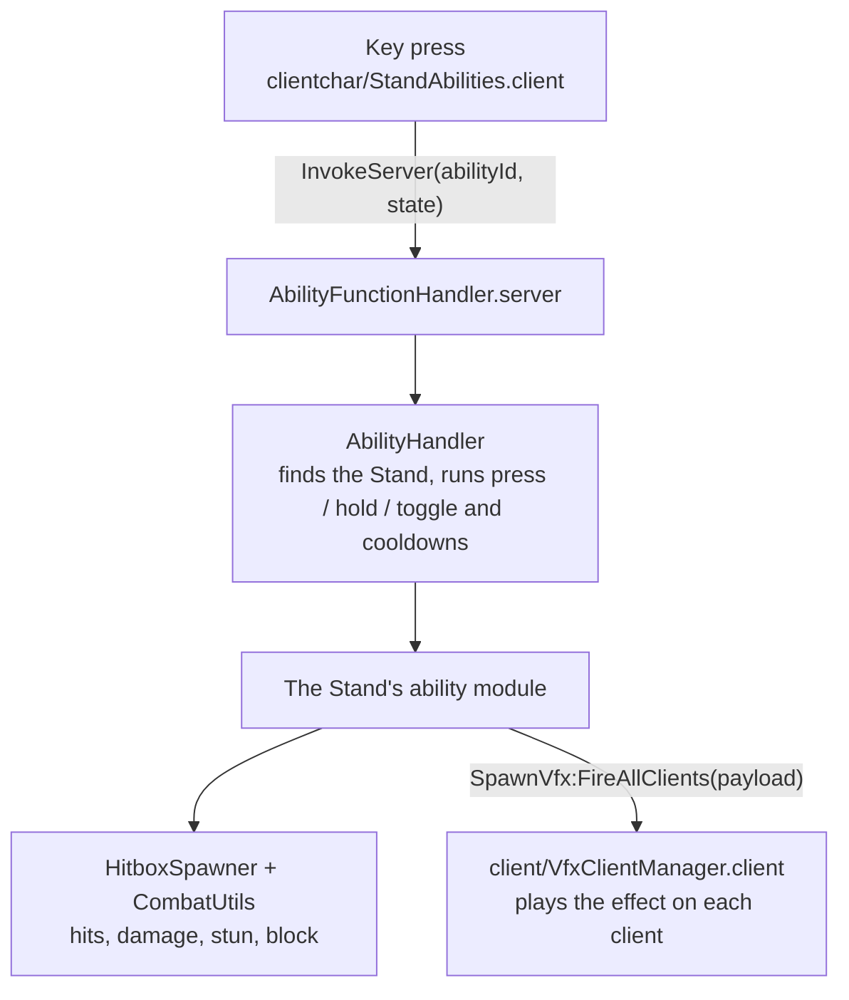

# Architecture

How the game fits together, and what I'd change. Paths are relative to `src/`.

## Layout

| Folder | Runs on | Roblox location |
|---|---|---|
| `server/` | Server | `ServerScriptService` |
| `shared/` | Both | `ReplicatedStorage.Shared` |
| `client/` | Client | `StarterPlayer.StarterPlayerScripts` |
| `clientchar/` | Each character | `StarterPlayer.StarterCharacterScripts` |

The filename sets how a script runs, not its folder: `.server.luau` is a server script, `.client.luau` is a client script, and plain `.luau` is a module. For example, `clientchar/Health.server.luau` runs on the server, once per character.

## An ability, from key press to effect

Input scripts stay thin and there's no client-side prediction, so the server decides the outcome of every ability. The server doesn't create the effects either: it sends a description, and the client owns the particle assets.

## Player data

- `server/DataSaving/ProfileStore.luau` is the third-party library that session-locks each profile.
- `server/DataSaving/PlayerData.luau` is the entry point. It loads the profile, fills in new template fields, and kicks the player if another server takes the session.
- `shared/Modules/PlayerData.luau` defines the saved schema.
- `server/DataSaving/SlotManager.luau` handles up to three character slots.

Gameplay systems such as `HeroManager`, `XPSystem`, `InventoryManager` and `QuestManager` keep their own in-memory state. It's copied to and from the profile on load, save and slot switch.

## Other systems

- **Movement speed:** `SlowingFieldRegistry` gives each slow its own key and multiplies the active slows together, so effects can overlap and end independently.
- **Quests:** `QuestDefinitions` is a data table, `QuestManager` tracks progress, and `QuestSerializer` converts it for saving.
- **Items:** `ItemUseManager` loads every module in `server/Rewards/Items/` into a registry by name.
- **Enemies and chests:** definition tables plus spawner classes. Spawners switch on and off based on player distance.

## What I'd change

The code grew alongside the game, so it has real debt. In priority order:

1. **No central list of remotes.** Scripts create remotes wherever they need them and look them up by hardcoded path, so a typo just hangs on `WaitForChild`. I'd add one shared module of remote names.
2. **Inconsistent server-side input checks.** Some slot and talent handlers validate arguments, but many combat remotes trust client-supplied targets and positions and rely on game logic to limit the effect. Exploiters can abuse that, so I'd validate at each remote.
3. **Duplicate save code.** `PlayerData.luau` copies fields by hand in three places, so a new field can silently fail to save if one is missed. I'd drive all three from one field list.
4. **Two ability dispatchers.** The Stand and specialty handlers are about 90% the same, so a fix in one can be missed in the other. They should share one implementation.
5. **Movement speed bypasses.** Many abilities set `Humanoid.WalkSpeed` directly instead of going through `CombatUtils`, and overlapping effects can overwrite each other. `UpdateMovement` should be the only place that writes it.
6. **Dead code.** Examples are `DataStoreManager`, `PlayerProfile`, `StandRegistry`, `NPCController` and `OldShiftLock`. These should be removed once confirmed unused.

There are also smaller known bugs:

- The `DefeatDIO` quest has `RewardItems` as a bare string, but the reward loop expects a list.
- `cleanupCharacter` never clears `moveSpeedMultiplierByCharacter`, which causes a small memory leak.
- The ocean and vehicle systems are still in flux: `WaveModule` is a stub, and `BoatController` doesn't read the input attributes `VehicleController` writes.
